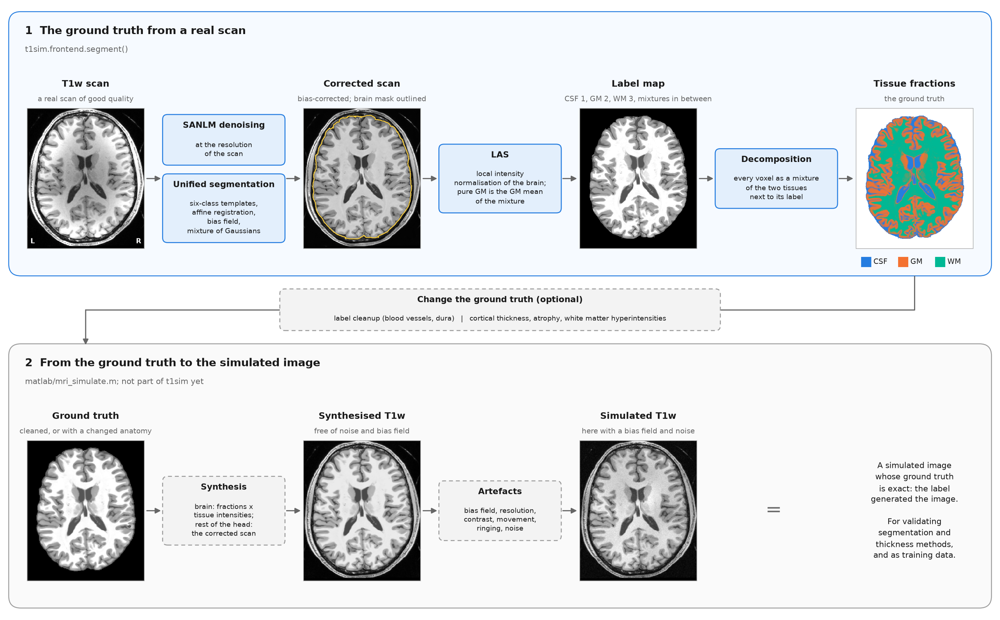
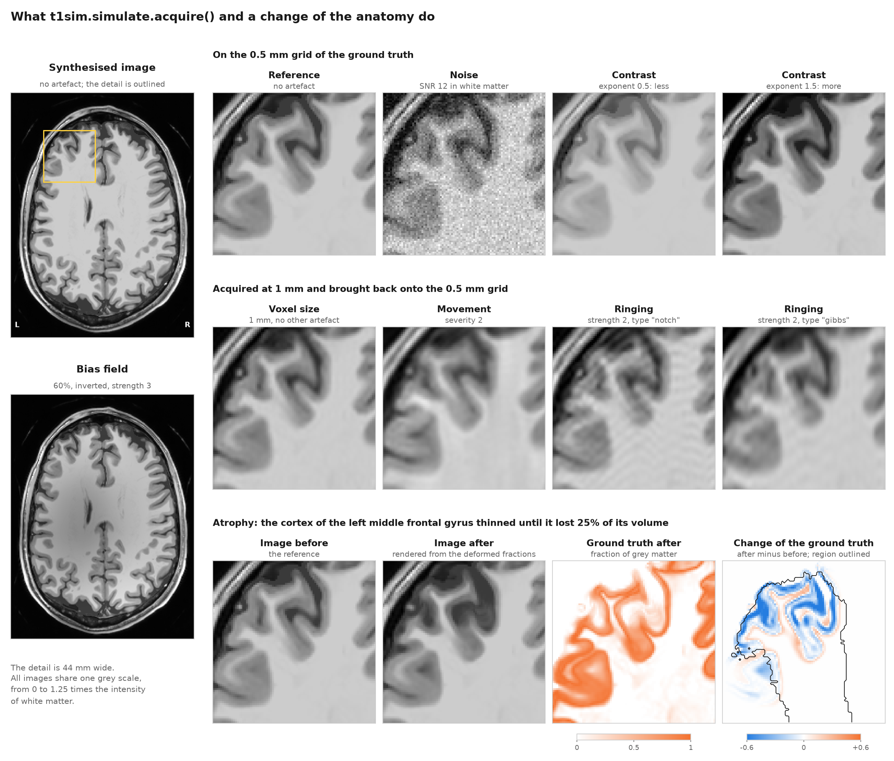

# t1sim

Simulated T1-weighted MR images with an exact ground truth, for validating segmentation and cortical thickness methods and for training data.

A real scan is turned into tissue fractions of CSF, GM and WM. These fractions are the ground truth, and the simulated image is rendered from them, with a bias field, noise, movement and other artefacts added. Because the ground truth generated the image, it is exact for that image, which the segmentation of a real scan can never be.



## Two implementations

- **`t1sim`**, the Python package in `src/t1sim/`, which this documentation describes.
- **The MATLAB tools** in [`matlab/`](matlab/README.md), from which it was ported.

| Step | `t1sim` | MATLAB tools |
| --- | --- | --- |
| Ground truth from a real scan: denoising, segmentation, intensity normalisation | yes | yes |
| Cleanup of the ground truth: blood vessels, dura, periventricular partial volume | yes | yes |
| Changed anatomy: cortical thickness | yes | yes |
| Changed anatomy: atrophy | yes, by a deformation | by scaling the CSF fraction |
| Changed anatomy: white matter hyperintensities | not yet | yes |
| Synthesis of the T1w image from the fractions | yes | yes |
| Artefacts: bias field, voxel size, contrast, movement, ringing, noise | yes | yes |
| BIDS output with JSON sidecars | yes | yes |
| Output on the grid of the scan | not yet: always affinely registered at 0.5 mm | yes |
| Geometric thickness phantom and its evaluation | yes | yes |

## Quick start

```bash
git clone https://github.com/ChristianGaser/T1-MRI-Phantom.git
cd T1-MRI-Phantom
pip install -e ".[frontend]"
```

```bash
t1sim sub-01_T1w.nii.gz --snr 30 --bias 20
```

```python
from t1sim import simulate

truth = simulate.ground_truth("sub-01_T1w.nii.gz")     # once per anatomy, about 2.5 minutes
for snr in (20, 40):
    acquired = simulate.acquire(truth, snr=snr)        # seconds each
    simulate.write(truth, acquired)
```

Every run writes the simulated image, the label map of its ground truth, the three tissue fractions and JSON sidecars, on a 0.5 mm grid that is affinely registered to MNI152NLin2009cAsym. The first run downloads the model files (44 MB). If the installation stops at T1Prep, see [Installation](docs/installation.md).



## Documentation

| Document | Contents |
| --- | --- |
| [Installation](docs/installation.md) | Requirements, installation, the model files and where they are kept |
| [Simulating images](docs/simulation.md) | The three steps, all options, the files that are written, the command line, timings |
| [The front end](docs/frontend.md) | How the ground truth is made from a scan |
| [Cleaning the ground truth](docs/cleanup.md) | Vessels, dura and periventricular partial volume |
| [Changing the anatomy](docs/anatomy.md) | Cortical thickness and atrophy, and a comparison of three kinds of atrophy |
| [Artefacts of the acquisition](docs/artefacts.md) | Bias field, voxel size, contrast, movement, ringing and noise, and what was checked |
| [Geometric thickness phantom](docs/phantom.md) | A folded phantom whose cortical thickness is exact by construction |
| [Training data for deepmriprep](docs/training-data.md) | Grid, file pairing and the settings that matter for training |
| [Agreement with the MATLAB tools](docs/validation.md) | The ground truth of `t1sim` against that of `mri_simulate.m`, and where the two differ on purpose |
| [Development](docs/development.md) | Layout of the repository, tests, how the figures are made |
| [MATLAB tools](matlab/README.md) | `mri_simulate.m` and the thickness phantom, with their own documentation |

## License

GNU General Public License, version 2; see [LICENSE](LICENSE).
