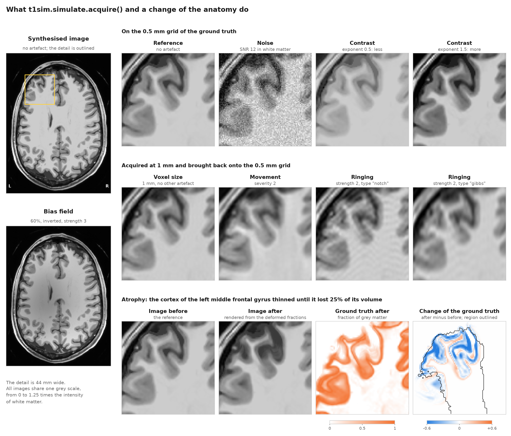

# Artefacts of the acquisition

Part of the [documentation of t1sim](../README.md#documentation).

`simulate.acquire` turns the image without artefacts into a simulated scan. No step touches the ground truth, except that a coarser voxel size averages it. The functions are in `t1sim.artefacts` (contrast, bias field, voxel size, noise) and `t1sim.kspace` (movement, ringing); the arguments of `acquire` are listed in [Simulating images](simulation.md#options-of-the-acquisition).

- [Order of the steps](#order-of-the-steps)
- [Contrast](#contrast)
- [Bias field](#bias-field)
- [Voxel size](#voxel-size)
- [Movement and ringing](#movement-and-ringing)
- [Noise](#noise)
- [What was checked](#what-was-checked)

## Order of the steps

The steps follow the acquisition of a scan:

1. **Contrast.** It belongs to the tissue and the sequence, so it comes first: the image is mixed again from the tissue intensities of that contrast.
2. **Bias field.** It belongs to the coil and multiplies whatever signal there is.
3. **Voxel size.** The image is acquired on the grid of the acquisition.
4. **Movement and ringing**, on that grid, because they are made on the acquisition matrix.
5. **Noise**, last: the noise of the scanner is no part of the moving object, and it is white on the grid of the acquisition.
6. Optionally the image is brought back onto the 0.5 mm grid (`upsample=True`).

## Contrast

`contrast` is the exponent of a power law around the intensity of white matter: white matter keeps its intensity, and the ratio of any two intensities is raised to the exponent.

| `contrast` | CSF / GM / WM on one scan | GM relative to WM |
| --- | --- | --- |
| `1` (none) | 148 / 380 / 501 | 0.76 |
| `0.5` | 272 / 436 / 501 | 0.87: less contrast |
| `1.5` | 80 / 331 / 501 | 0.66: more contrast |

The power law is applied to the three tissue intensities and to what is not brain, and the image is then mixed from the fractions again. A voxel of two tissues therefore stays the mixture of their intensities, which is what it is in a scan of another contrast, and the ground truth stays exact. `mri_simulate.m` applies the power law to the finished image instead; why `t1sim` does not is in [What was checked](#what-was-checked).

## Bias field

A smooth field with a mean of 1 that the image is multiplied with. `bias_percent` is its amplitude, peak to peak over the volume; a negative value swaps bright and dark.

- **Simulated** (`bias_type=(strength, seed)`): a random field of `2**strength` voxels per axis, low-pass filtered, brought to the size of the image and smoothed with 15 mm. A larger strength (1 to 4) gives a field with more local detail. For one seed it is the field `matlab/mri_simulate.m` makes. Inside the brain a field of 30% spanned 27% on one scan.
- **Stored** (`bias_type="A"`, `"B"`, `"C"`, or a file): measured fields in template space (`matlab/rf100_*.nii`), brought onto the grid through the deformation of the segmentation. Here `bias_percent` is the percentage of the stored field; with 30 the three fields spanned 30 to 31% over the brain of that scan. The first axial plane of the three files holds half the value of the plane above it, an edge that was once interpolated against zeros; `t1sim` replaces such a plane by its neighbour, and continues the field where the deformation is not defined.

## Voxel size

`resolution` is the voxel size of the acquisition.

- **The image is acquired.** Its k-space is cut at the Nyquist frequency of the new voxel size along every axis that gets coarser, which is what a smaller acquisition matrix does, Gibbs ringing included. The band-limited image is then read at the new voxel centres.
- **The ground truth is averaged.** Every new voxel holds the mean of the fractions over the box it covers, which is the partial volume of that voxel. The tissue volumes stay what they were.
- **The grid** has as many whole voxels as fit into the field of view, centred, so the voxel size is exactly the one asked for.

The two are not the same filter, as they are not in a scanner: next to a sharp boundary the image rings around the mixture that the averaged fractions give (see [How exact the ground truth is](validation.md#how-exact-the-ground-truth-is)). The cut is periodic, as an FFT is, so what touches one end of the field of view, such as the neck, rings faintly into the first planes of the other end.

With `upsample=True` the acquired image is brought back onto the 0.5 mm grid by cubic B-spline interpolation, and the ground truth keeps its 0.5 mm voxels. This is a scan of that voxel size after resampling, the form in which most real data reaches a network that works at 0.5 mm.

## Movement and ringing

Both are made in k-space, on the grid of the acquisition, and share one k-space when both are asked for.

**Movement** (`motion`). k-space is assembled from blocks of phase-encoding lines that are taken from rigidly moved copies of the image. Translations are exact phase ramps; rotations resample the volume with the windowed sinc SPM uses. The movement is a number of events, nods with a residual offset, with a slow drift and tremor between them.

| `motion` | Events | Largest translation and rotation |
| --- | --- | --- |
| `1` (mild) | 1 | 1 mm, 1 degree |
| `2` (moderate) | 3 | 2.8 mm, 2.8 degrees |
| `3` (severe) | 5 | 5.2 mm, 5.2 degrees |

A dict sets single values instead: `severity`, `events`, `translation` (mm), `rotation` (degrees), `blocks` (number of k-space blocks, 32), `continuous` (drift and tremor as a fraction of `translation`, 0.2), `pe` (phase-encoding direction: a voxel axis 0, 1, 2 counted from 0, or a world axis `"x"`, `"y"`, `"z"`; `"y"`), `ordering` (`"linear"` or `"centric"`) and `centre` (put the first event where the centre of k-space is sampled, `True`).

The image is kept on its ground truth. Subtracting the mean pose, weighted by the k-space energy of the blocks, puts the complex image where the unmoved object is, but the image that is written is its magnitude, and the magnitude is not linear: it was left 0.4 to 1.6 mm away. `t1sim` therefore estimates the displacement that is left, from the cross-correlation with the unmoved image, and removes it with a phase ramp on the assembled k-space, which costs no interpolation. The sidecar holds what was removed (`Recentred`), and its `Pose` is the movement of every block relative to the image that is written.

**Ringing** (`ringing`). A strength, or a dict with `strength`, `type`, `pe` (as above, or `"all"`) and `k0`:

- `type="notch"` (default) damps or inverts a narrow band of k-space at `k0` of the Nyquist frequency (0.6). It lays pronounced regular ripples over the image without blurring it. No scanner does this; it is the ringing of augmentation tools, kept for that use.
- `type="gibbs"` cuts k-space off at `0.7 - 0.15 * strength` of the Nyquist frequency, which is what a short acquisition matrix does: an overshoot of 9% at every edge whatever the strength, with ripples and a blur that widen with it.

The model is that of `matlab/mri_simulate.m`; [its documentation](../matlab/docs/artefacts.md) describes it in full (there the axes count from 1).

## Noise

`snr` gives Rician noise: Gaussian noise of one standard deviation in the real and in the imaginary part of the signal, `sqrt((s + n1)**2 + n2**2)`. The standard deviation is the intensity of white matter divided by `snr`.

- A contrast change leaves white matter where it is, so the SNR is the same for every contrast.
- The bias field has a mean of 1 and is not part of it: where the field is dark, the local SNR is lower, as in a scan.
- The noise has no upper limit.
- `noise_percent` gives Gaussian noise instead, in percent of the white matter intensity. The image stays non-negative.
- With `seed=None` every output file gets noise of its own.

With `upsample=True` the noise is white at the voxel size of the acquisition and correlated on the 0.5 mm grid. `NoiseSD` of the sidecar is that of the acquisition. On the fine grid, for a 1 mm acquisition, the standard deviation is 0.82 of it on average, with a correlation of 0.69 between neighbours, and it depends on where a fine voxel lies between the acquired ones: 0.75 to 0.89 from plane to plane.

## What was checked

**Noise**, each case against the same acquisition without noise, in voxels of pure white matter (0.75 mm MPRAGE, SNR 25):

| Case | Nominal SD | SD in WM | Mean shift in WM (Rician theory) | SNR in WM | Correlation of neighbours |
| --- | --- | --- | --- | --- | --- |
| No bias field | 20.04 | 20.02 | +0.42 (+0.40) | 25.0 | 0.000 |
| Bias field 45%, strength 4 | 20.04 | 20.02 | +0.42 (+0.40) | 24.9 | 0.000 |
| Contrast 0.5 | 20.04 | 20.02 | +0.42 (+0.40) | 25.0 | 0.000 |
| Contrast 1.5 | 20.04 | 20.02 | +0.42 (+0.40) | 25.0 | 0.000 |
| Acquired at 1 mm | 20.04 | 20.12 | +0.39 (+0.40) | 24.9 | 0.000 |
| 1 mm, back on 0.5 mm | 20.04 | 16.41 | +0.38 | 30.5 | 0.69 |
| 5% Gaussian | 25.05 | 25.04 | +0.03 (0) | 20.0 | 0.000 |

On the grid of the acquisition GM and CSF have the SD of WM (19.97 to 20.08). The one exception is CSF at a contrast of 1.5 (19.75): its signal is then only 4 times the noise, where the Rician distribution is narrower. The background has the Rayleigh floor (mean 26.1, SD 13.6 for an expected 25.1 and 13.1 above a clean background of 6.7).

**Contrast**, on the same scan:

| Measure | Power law on the finished image, after the bias field (`mri_simulate.m`) | On the tissue intensities, before it (`t1sim`) |
| --- | --- | --- |
| A bias field that spans 25.1% in white matter, with exponent 0.5 / 1.5 | 12.2% / 40.2% in the image | 25.1% / 25.1% |
| Apparent shift of the pial boundary, 0.5 / 1.5 | +0.07 / -0.07 mm | 0 |
| Apparent shift of the GM/WM boundary, 0.5 / 1.5 | +0.02 / -0.02 mm | 0 |
| Largest deviation of a brain voxel from the mixture of its fractions | - | 0.0001 of 501 |

The shift is what a method finds that takes a voxel as the linear mixture of its two tissues: the power law of a mixture is not the mixture of the power laws.

**Movement**, the distance between the image and its ground truth (the translation that fits the unmoved image best):

| Severity | Head-sized object, without / with recentring | Real head at 1 mm, without / with |
| --- | --- | --- |
| 1 | 0.47 / 0.005 voxels | 0.40 / 0.11 mm |
| 2 | 1.37 / 0.03 voxels | 0.85 / 0.21 mm |
| 3 | 1.95 / 0.04 voxels | 1.56 / 0.46 mm |

The object was measured for four seeds each. The real head is one seed, measured with a simpler fit that reads 0.06 to 0.24 mm even for ringing alone, which does not move the image at all; its values with recentring are at that floor for severity 1 and 2. A rotation of the apparent object is not removed.

Bias field, movement and ringing give the result of `matlab/mri_simulate.m` for the same input (movement without the recentring); the numbers are in [Agreement with the MATLAB tools](matlab-agreement.md#summary), together with the properties of the MATLAB version that were not carried over.
