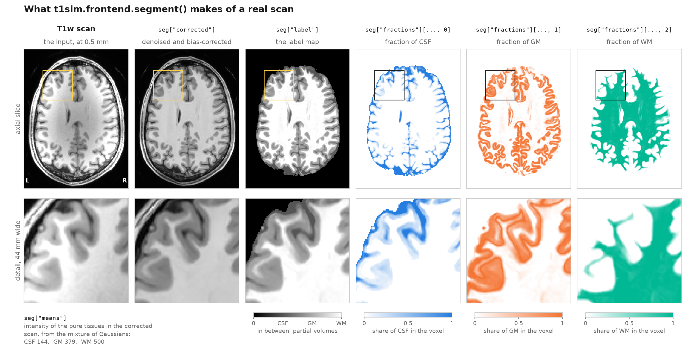

# The front end: tissue fractions from a real scan

Part of the [documentation of t1sim](../README.md#documentation).

`t1sim.frontend` turns a real T1-weighted scan into a label map with partial volumes and into the tissue fractions the simulation is built on. It is the first row of the [scheme](../README.md). `simulate.ground_truth` calls it; it is used on its own to look at these fractions or to reuse them (`ground_truth(scan, seg=seg)`).

- [Usage](#usage)
- [What is returned](#what-is-returned)
- [How the fractions are made](#how-the-fractions-are-made)
- [Where the intensities come from](#where-the-intensities-come-from)
- [The grid of the anatomy](#the-grid-of-the-anatomy)
- [What comes after it](#what-comes-after-it)

## Usage

```python
from t1sim import frontend

seg = frontend.segment("sub-01_T1w.nii.gz")
```

| Argument | Meaning (default) |
| --- | --- |
| `t1` | The scan: a file name or a nibabel image, in any storage order. A single 3-D volume |
| `template_dir` | Folder with the six-class shooting templates (the [model files](installation.md#model-files), downloaded on the first run) |
| `verbose` | Print the stages of the segmentation (`False`) |
| `deformation` | Also return the deformation to the templates, which the atlases need (`False`) |
| `space` | Where the anatomy is made: `"scan"`, on the scan at 0.5 mm along its own axes, or `"template"`, on T1Prep's working grid in template space; see [below](#the-grid-of-the-anatomy) (`"scan"`) |

A run takes about 90 s on an M2 MacBook Air for a 0.75 mm scan, in either space: 21 s for the denoising, 59 s for the segmentation and 8 s for LAS on the working grid. On the grid of the scan the affine registration has to run before the segmentation, which is handed the grid in template millimetres; a T1Prep whose `unified_seg.segment` takes the registration (`world`, newer than 0.9.3) runs it once, an older one twice, which costs 20 s more. Both give the same result to the last bit. The deformation costs no extra time.

## What is returned

A dict. All volumes lie on the [grid of the anatomy](#the-grid-of-the-anatomy) and are indexed `[x, y, z]` in RAS order.



| Key | Type | Contents |
| --- | --- | --- |
| `label` | (X, Y, Z) float32 | The label map: 0 outside the brain, CSF = 1, GM = 2, WM = 3, partial volumes in between |
| `fractions` | (X, Y, Z, 3) float32 | Fractions of CSF, GM and WM, in this order (`frontend.TISSUES`). They sum to 1 inside the brain and are 0 outside, and 0 as well in the brain voxels of 4 or more in `normalised` (see step 5 below) |
| `corrected` | (X, Y, Z) float32 | The denoised and bias-corrected scan, whole head |
| `mask` | (X, Y, Z) bool | The brain mask |
| `means` | dict | Intensity of pure CSF, GM and WM on the scale of `corrected` |
| `normalised` | (X, Y, Z) float32 | The LAS-normalised brain the label was made from, on the scale of the label: at least 0.01 inside the brain, up to 5 for what is brighter than WM, and 0 outside |
| `grid` | nibabel image | The grid of the anatomy; its affine maps the voxels to the millimetres of its `space`: those of the scan by default |
| `space` | str | `"scan"` or `"template"`: where the anatomy is made |
| `template_affine` | 4 x 4 | The voxel-to-world matrix of the grid in template millimetres, through which priors and atlases of the template space are placed |
| `template_grid` | dict | `shape` and `affine` of T1Prep's working grid in template space, onto which `simulate.acquire(grid="working")` writes |
| `world` | 4 x 4 | The affine registration: scan millimetres to template millimetres |
| `affine` | 4 x 4 | The same registration in the normalised coordinates T1Prep resamples with (`t1prep.unified_seg.grid_affine`) |
| `native_mat`, `native_shape` | 4 x 4, tuple | Voxel-to-world matrix and shape of the scan in RAS order |
| `scan` | nibabel image | The denoised scan on its own grid, in the storage order of the input: the grid `simulate.acquire` writes on by default, and what it takes from the scan beyond the grid of the anatomy |
| `params` | dict | Everything the segmentation estimated: the mixture of Gaussians, the bias field, volumes, timings |
| `iy`, `template_mat` | (X, Y, Z, 3) float32, 4 x 4 | With `deformation=True`: for every voxel the voxel of the segmentation's templates it maps to, and the voxel-to-world matrix of those templates. `t1sim.atlas.to_grid` brings an atlas onto the grid with them |

A voxel of the grid of the anatomy lies in the scan at

```python
import numpy as np

in_scan_mm = seg["grid"].affine                                    # space "scan"
# in_scan_mm = np.linalg.inv(seg["world"]) @ seg["grid"].affine    # space "template"
i, j, k, _ = np.linalg.inv(seg["native_mat"]) @ in_scan_mm @ [x, y, z, 1]   # voxel of the scan in RAS order
```

`docs/make_figures.py` samples the scan this way for the first panel of the figure above.

## How the fractions are made

1. **Denoising.** The scan is filtered with SANLM (`cat_surf.vol_sanlm`) at its own resolution, before anything is resampled. After resampling the noise is no longer white, and the filter removes little of it.
2. **Unified segmentation.** `t1prep.unified_seg.segment` runs CAT-Surface's implementation of SPM's unified segmentation (`cat_surf.vol_unified_seg`). It registers the scan affinely to the template, estimates the bias field and describes the intensities by a mixture of Gaussians. Its tissue priors are shooting templates with six classes (GM, WM, CSF, bone, soft tissue, air), deformed onto the scan by geodesic shooting. It gives the bias-corrected scan on the [grid of the anatomy](#the-grid-of-the-anatomy), a first label map and the posteriors of the classes.
3. **Brain mask.** The brain is where the posteriors of GM, WM and CSF together reach 0.5: the largest connected component, with its cavities filled.
4. **LAS.** `t1prep.apply_LAS`, the local adaptive segmentation known from CAT12, maps the brain onto the scale CSF = 1, GM = 2, WM = 3. A global step puts the tissues at these values; a local step follows each tissue with a smooth field of its own and removes what is left of intensity differences within it. The result is the label map.
5. **Decomposition.** `frontend.fractions_from_label` reads a label between two tissues as their linear mixture: 2.5 is half GM and half WM. A brain voxel darker than CSF is CSF, and one brighter than WM is WM, up to a third brighter. From 4 on, a voxel has no fractions and no label: it is no brain tissue, and the simulated image keeps the scan there. These are the cores of the brightest vessels, 0.0 ml on a scan with few vessels and 3.3 ml on one with many; the [cleanup](cleanup.md) makes them CSF in the ground truth.

No second segmentation takes part: the fractions are a function of the intensities of the scan and of nothing else. That is also their limit. A structure is what its intensity says: the deep grey nuclei, brighter than cortex, are mixtures of GM and WM, and whatever is as bright as grey matter is grey matter until the cleanup corrects it.

## Where the intensities come from

Two intensities decide what the simulated image will look like. Both are read from the mixture of Gaussians the segmentation estimated; neither is estimated a second time.

**The tissue intensities for the synthesis** (`seg["means"]`, from `frontend.tissue_means`). For GM and WM this is the mean of their Gaussians, weighted by the mixing proportions. For CSF it is its darkest Gaussian: the segmentation describes CSF by two Gaussians, and the brighter one regularly covers GM.

**The intensity of pure GM in LAS.** `frontend.segment` hands LAS the GM mean of the mixture (`apply_LAS(..., peaks=(None, gm, None))`). A voxel as bright as that mean gets the label 2, and the synthesis later renders the label 2 at that same intensity, so the simulated image stays a re-rendering of the scan. CSF and WM keep the estimates LAS makes itself.

Left to its own estimate, LAS put pure GM lower: at 358 instead of 380 on the scan of the [comparison with the MATLAB tools](matlab-agreement.md#the-intensity-of-pure-gm), which is 6%. That moved the GM/WM boundary of the label by 0.14 mm and made WM 7% larger.

## The grid of the anatomy

The anatomy, everything `t1sim` makes and changes, lies on a grid of 0.5 mm voxels. `space` decides which:

| | `space="scan"` (default) | `space="template"` |
| --- | --- | --- |
| Grid | The scan, cut into voxels of 0.5 mm along its own axes | T1Prep's working grid (`t1prep.unified_seg.default_working_grid()`) |
| Millimetres | Those of the scan: the head has the size of the subject | Those of MNI152NLin2009cAsym, reached by an affine registration: the head has the size of the template |
| Extent | The part of the field of view of the scan that the working grid covers, 2 mm more at every side; on a 0.75 mm scan 312 x 428 x 420 voxels | 339 x 411 x 339 voxels from (-84, -120, -72) mm |
| Back onto the grid of the scan | Along its own axes: a scan voxel of 1 mm is two by two by two voxels of the anatomy | Through the registration, at an angle |
| Use | Validation in the space of the subject, the default | Training data for networks that work in template space ([Training data](training-data.md)) |

The fine voxels start at the outer face of the first voxel of the scan, so every voxel of the scan whose size is a multiple of 0.5 mm is a whole number of them. The scan is resampled onto the grid once, after the denoising; on the grid of the scan that is a mere upsampling, with no rotation. The extent stays that of the working grid because the templates of the segmentation end there; what a scan shows beyond it, the neck mostly, is taken from the scan when an image is written on its grid ([Simulating images](simulation.md#on-the-grid-of-the-scan)).

**Lengths and volumes are those of the space.** Everything `t1sim` is given or reports about the anatomy refers to the grid it is made on: a cortical thickness in mm, the reach of an atrophy, the 4 mm of the dura rule, the ml of a sidecar. By default these are millimetres of the subject. In template space they are not: the registration is a full affine one, which scales the head, and a cortex of 2.5 mm there is 2.2 to 2.5 mm thick in the head of the first subject below, depending on the direction:

| Scan | Lengths in template space along x / y / z | Volumes |
| --- | --- | --- |
| 0.75 mm MPRAGE | 1.12 / 1.01 / 1.12 times those of the scan | 1.26 times |
| 0.7 mm scan | 1.15 / 1.02 / 1.20 times | 1.42 times |

`seg["world"]` holds the registration, and its determinant, the factor of the volumes, is written to every sidecar (`AffineVolumeScaling`).

**The two grids give slightly different anatomies.** The segmentation and LAS run on the grid they are given. On the 0.75 mm MPRAGE the scan's own grid gave 348 / 687 / 588 ml of CSF / GM / WM; the working grid gave 351 / 674 / 594 ml, its sums divided by the factor of the registration. `mri_simulate.m`, which segments on the grid of the scan as well, gave 348 / 708 / 577 ml. So the anatomy made on the scan is 2% richer in grey matter, and closer to that of `mri_simulate.m`.

## What comes after it

The front end returns the fractions as segmented and writes nothing. [Cleaning the ground truth](cleanup.md), [changing the anatomy](anatomy.md), the synthesis, the [artefacts](artefacts.md) and the files are the steps of [`t1sim.simulate`](simulation.md).
