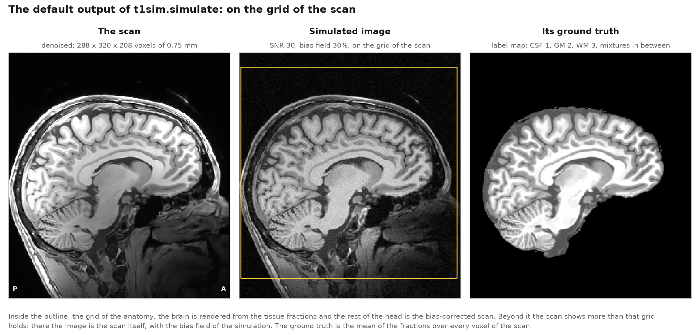

# Simulating images

Part of the [documentation of t1sim](../README.md#documentation).

`t1sim.simulate` runs the whole path from a real scan to simulated images with their ground truth. It has three steps, which can also be called on their own.

- [In one call](#in-one-call)
- [The three steps](#the-three-steps)
- [Options of the anatomy](#options-of-the-anatomy)
- [Options of the acquisition](#options-of-the-acquisition)
- [Options of the output](#options-of-the-output)
- [The grid of the output](#the-grid-of-the-output)
- [What is written](#what-is-written)
- [Command line](#command-line)
- [How long it takes](#how-long-it-takes)

## In one call

```python
from t1sim import simulate

result = simulate.simulate("sub-01_T1w.nii.gz", snr=30, bias_percent=20)
result["files"]["T1w"]     # the simulated image
result["files"]["dseg"]    # its ground truth label map
result["files"]["probseg"] # {"CSF": ..., "GM": ..., "WM": ...}: the tissue fractions
```

`simulate` takes the options of all three steps below. With `truth=` it takes a ground truth that was made before, and then makes another image of it.

## The three steps

```python
truth = simulate.ground_truth("sub-01_T1w.nii.gz")          # once per anatomy, about two minutes
for snr in (20, 40):
    acquired = simulate.acquire(truth, snr=snr)             # seconds each
    simulate.write(truth, acquired)
```

| Step | Does | Cost |
| --- | --- | --- |
| `ground_truth(scan, ...)` | Runs the [front end](frontend.md), changes the [anatomy](anatomy.md) if asked, [cleans](cleanup.md) the ground truth and renders the image without artefacts | Minutes, once |
| `acquire(truth, ...)` | Makes one image: [contrast, bias field, voxel size, movement, ringing, noise](artefacts.md) | Seconds |
| `write(truth, acquired, ...)` | Stores the image and the ground truth with names and sidecars after BIDS | Seconds |

Any number of acquisitions can share one ground truth; `acquire` does not change it.

`ground_truth` returns two sets of fractions. The image is rendered from the fractions as the front end made them (`truth["image_fractions"]`), and the ground truth is the same fractions after the cleanup (`truth["fractions"]`, with `truth["label"]`). So a vessel stays bright in the image and is CSF in the ground truth. Without a cleanup the two are the same array.

## Options of the anatomy

Arguments of `ground_truth`, which `simulate` passes on:

| Argument | Meaning (default) |
| --- | --- |
| `space` | Where the anatomy is made, and whose millimetres its lengths are: `"scan"`, on the scan at 0.5 mm along its own axes, or `"template"`, on T1Prep's working grid in template space; see [The grid of the anatomy](frontend.md#the-grid-of-the-anatomy) (`"scan"`) |
| `thickness` | Give the cortex this thickness in mm of the `space`: one value, or three for the mainly occipital parcels, the rest and the mainly frontal parcels (`0`: keep the cortex) |
| `atrophy` | Atrophy of regions of an atlas: a dict, or a list of dicts, see below (`None`) |
| `clean` | Clean the ground truth: `True`, `False`, or a dict with `vessels`, `dura`, `pve`, see [Cleaning the ground truth](cleanup.md) (`True`) |
| `template_dir` | Folder with the templates of the segmentation (`None`: the [model files](installation.md#model-files)) |
| `verbose` | Print the steps (`False`) |

`ground_truth` alone also takes `seg`, a result of `frontend.segment(scan, deformation=True)` to start from; its space is then that of `seg`.

Keys of an `atrophy`:

| Key | Meaning (default) |
| --- | --- |
| `regions` | Numbers of the regions in the atlas; they are deformed one after the other |
| `change` | Relative change of the volume of their tissue, between -0.5 and 0.5: `-0.1` is a loss of 10%. One value, or one per region |
| `atlas` | An atlas of T1Prep by name, or the file of an atlas in template space (`"Hammers"`) |
| `mode` | `"thinning"` or `"volume"` (`"thinning"`) |
| `tissues` | The tissues whose change is meant: `("GM",)` or `("GM", "WM")` (`("GM",)`) |
| `reach` | Distance in mm of the `space` within which the CSF around the region takes up the space (`10`) |

`thickness` and `atrophy` cannot be combined. [Changing the anatomy](anatomy.md) explains both and says what `change` means exactly.

## Options of the acquisition

Arguments of `acquire`, which `simulate` passes on. [Artefacts of the acquisition](artefacts.md) describes what each does.

| Argument | Meaning (default) |
| --- | --- |
| `snr` | Rician noise for this SNR in white matter; `0` uses `noise_percent` (`40`) |
| `noise_percent` | Gaussian noise in percent of the white matter intensity, with `snr=0` (`0`) |
| `bias_percent` | Amplitude of the bias field in percent, peak to peak; `0` for none, negative to invert it (`30`) |
| `bias_type` | `(strength, seed)` of a simulated field, or `"A"`, `"B"`, `"C"` or a file for a stored one. A seed of `None` gives every scan a field of its own (`(2, 0)`) |
| `contrast` | Exponent of the contrast change: below 1 for less contrast between the tissues, above 1 for more (`1`) |
| `resolution` | Voxel size of the acquisition in mm, one value or three (`None`: that of the grid). Three values go along the axes of the output grid: on the grid of the scan in the order the scan is stored in, on the other grids in RAS order, so `(1, 1, 3)` is not the same axis on both for a scan stored in another order |
| `upsample` | With a `resolution` on a 0.5 mm grid (`"anatomy"`, `"working"`, `"deepmriprep"`): bring the acquired image back onto the 0.5 mm grid, where the ground truth stays. `False`: the ground truth is averaged to the voxels of the acquisition. Without a `resolution` it does nothing (`False`) |
| `motion` | Movement artefacts: a severity, or a dict (`0`) |
| `ringing` | Ringing: a strength, or a dict (`0`) |
| `seed` | Seed of noise and movement. `None`: derived from the folder and the name of the scan and from the settings, so every output file has noise of its own that is the same in every run (`None`) |
| `grid` | Where the image and its ground truth are written: `"scan"`, `"anatomy"`, `"working"` or `"deepmriprep"`; see [The grid of the output](#the-grid-of-the-output) (`"scan"`) |

## Options of the output

Arguments of `write`, which `simulate` passes on:

| Argument | Meaning (default) |
| --- | --- |
| `out_dir` | Folder of the outputs (`None`: see [Where](#what-is-written)) |
| `derivatives` | With `out_dir=None`: write into a `derivatives` folder; `False` writes next to the scan (`True`) |
| `save_bias` | Also write the bias field (`False`) |
| `save_jacobian` | Also write the Jacobian determinant of an atrophy (`True`) |
| `compress` | Write `.nii.gz`; `False` writes `.nii` (`True`) |

## The grid of the output

The anatomy is made on a 0.5 mm grid, by default the scan's own ([The grid of the anatomy](frontend.md#the-grid-of-the-anatomy)). `grid` says where an image of it is written:

| `grid` | Image and ground truth lie | The ground truth there | Use |
| --- | --- | --- | --- |
| `"scan"` (default) | On the grid of the scan: its voxels, its orientation and storage order, its field of view and its world coordinates | The mean of the fractions over every voxel of the scan | Validation: the input a pipeline is built for, lying on the scan voxel by voxel |
| `"anatomy"` | On the 0.5 mm grid the anatomy is made on, in its space, or on one of another voxel size inside it (`resolution`) | The anatomy as it was made, nothing averaged | Validation at 0.5 mm |
| `"working"` | On T1Prep's working grid in template space (339 x 411 x 339), or one of another voxel size inside it | Averaged from an anatomy made on the scan; as it was made from one made in template space | Comparisons in template space |
| `"deepmriprep"` | On the 336 x 384 x 336 voxels of the working grid that deepmriprep trains on | As for `"working"` | [Training data](training-data.md), with `space="template"` |

Wherever an image goes onto another grid, its k-space is cut to that of the new grid, it is read at the new voxel centres by a cubic B-spline, and what that swings below 0 next to an edge is set to 0. A ground truth is never interpolated but averaged over the new voxels; see [Voxel size](artefacts.md#voxel-size).

### On the grid of the scan



- **From an anatomy made on the scan**, the default, image and ground truth go back along the scan's own axes: a scan voxel of 1 mm is two by two by two voxels of the anatomy, one of 0.75 mm one and a half along every axis, and the mean over it is exact.
- **From an anatomy made in template space** the voxels of the scan are turned against the grid of the anatomy, and every voxel of the scan is a parallelepiped in it; the mean over it is exact to a few thousandths ([Voxel size](artefacts.md#voxel-size)).
- **Movement, ringing and noise** follow on the grid of the scan, so the millimetres of a movement are those of the subject and the noise is white there.
- **Beyond the grid of the anatomy** a scan usually shows more: the neck, the lower face, more air; on one scan 17% of the head. There the image is the denoised scan itself, brought to the intensities of the bias-corrected scan next to it and given the contrast and the bias field of the simulation. The two are blended over 3 mm, at the faces of the grid of the anatomy that the scan reaches beyond; where the grid of the anatomy reaches a face of the field of view, the image is the simulation up to that face.
- **`resolution`** gives another voxel size along the axes and in the field of view of the scan, in millimetres of the scan; three values in the order the scan is stored in. `upsample` is not available.

Checked on a 0.75 mm scan stored in another order than RAS (288 x 320 x 208), with the anatomy made on it: the tissue volumes on the grid of the scan equal those of the anatomy to 3e-10, the image lies within 0.03 mm of the denoised scan, the noise in white matter has a standard deviation of 16.8 for a nominal 16.7, and nothing that is written is below 0. The grid of the anatomy covers all of the head the scan shows but 4.6%, the lower neck.

## What is written

For `sub-01_T1w.nii.gz` with `snr=30, bias_percent=20`:

```text
sub-01_desc-snr30Rf20T2_T1w.nii.gz            the simulated image
sub-01_desc-snr30Rf20T2_T1w.json              its parameters
sub-01_desc-Clean_dseg.nii.gz                 label map of the ground truth
sub-01_desc-Clean_dseg.json
sub-01_desc-Clean_label-GM_probseg.nii.gz     and _label-WM_, _label-CSF_
```

With `grid="anatomy"` from an anatomy made on the scan, the names carry the voxel size; with `grid="working"` or `"deepmriprep"` the space as well:

```text
sub-01_res-0p5mm_desc-snr30Rf20T2_T1w.nii.gz
sub-01_space-MNI152NLin2009cAsym_res-0p5mm_desc-snr30Rf20T2_T1w.nii.gz
```

- **Where.** For a scan inside a BIDS dataset: in `derivatives/t1sim-<version>/` at the root of the dataset, with the folders of subject and session kept. For any other scan: in `derivatives/t1sim-<version>/<folder of the scan>/` next to the folder of the scan, so that scans of one name in different folders do not replace each other. `out_dir` names another folder, and `derivatives=False` writes next to the scan.
- **In the space of the scan** (`grid="scan"`, and `"anatomy"` from an anatomy made on the scan) the names carry no `space`, and a `res` only where the voxels are not those of the scan (`sub-01_res-1mm_desc-...`), as `matlab/mri_simulate.m` names them. The world coordinates and their NIfTI code are those of the scan.
- **In template space** (`grid="working"` and `"deepmriprep"`) the outputs are affinely registered to MNI152NLin2009cAsym. The registration scales the head, so lengths and volumes are those of the template and not of the subject; see [The grid of the anatomy](frontend.md#the-grid-of-the-anatomy). The voxels are 0.5 mm, or those of the acquisition with `resolution` and without `upsample`.
- **Ground truth.** The fractions (`probseg`, 8 bit in steps of 1/255) are the ground truth. The label map (`dseg`, 16 bit in steps of 1/765) is a view of them, `CSF + 2 GM + 3 WM`: 2.5 is half GM and half WM. Read back, a pure voxel is 1 or 3 to within 1e-7, not exactly.
- **Sidecar of the image.** `SimulationParameters` holds every setting, the seeds, the noise SD that was used, the tissue intensities, the volumes the cleanup corrected, what an atrophy reached, and for movement the pose of every block of k-space. `AnatomySpace` says where the anatomy was made; `VolumeMl` and `TissueChangeMl` are ml of that space, of the subject by default. `AffineVolumeScaling` is the volume of the head in template space over its volume in the scan.
- **Atrophy.** The Jacobian determinant of the deformation is written as `..._jacobian.nii.gz`. It lies on the anatomy before the atrophy, not on the label map next to it; see [Atrophy](anatomy.md#atrophy).
- **Bias field.** With `save_bias` the field is written as `..._desc-<tags of the image>Biasfield_T1w.nii.gz`.

### Names

The scheme is that of `matlab/mri_simulate.m`. The `desc` of the image holds the tags of the acquisition followed by those of the anatomy; the `desc` of the ground truth holds those of the anatomy and `Clean`. Images that differ in the acquisition alone share one ground truth.

| Tag, in this order | Stands for |
| --- | --- |
| `snr30`, `pn3` | SNR 30; 3% Gaussian noise |
| `Rf20T2`, `Rf20T2S7`, `RfNeg20T2`, `Rf20A` | Bias field of 20%: simulated with strength 2; with a seed of 7 instead of 0; inverted; the stored field A |
| `Acq1mm`, `Acq1x1x1p5mm` | Acquired at this voxel size and brought back onto the grid |
| `ConLow`, `ConHigh`, `Con1p3` | Contrast exponent 0.5, 1.5, 1.3 |
| `Motion2`, `Ringing2`, `Ringing2Gibbs` | Movement of severity 2; ringing of strength 2, of type notch or gibbs |
| `Seed5` | A seed that was given, also 0 |
| `Thickness25mm`, `Thickness15to25mm` | Cortical thickness of 2.5 mm; three values from 1.5 to 2.5 mm |
| `HammersRoi28Thin10`, `HammersRoi28Vol10`, `HammersRoi28ThinPlus10` | Atrophy of region 28 by 10%, thinning or volume; a gain of 10% |
| `HammersMulti` | Atrophy of several regions |

The names do not hold every setting: not the space of the anatomy, the options of the cleanup, the reach of an atrophy, the middle one of three thickness values, the regions of a `Multi`, or the output grid. `write` therefore refuses to replace a ground truth that was made with other settings or on another grid, because the images already in the folder would be left with a ground truth that is not theirs. Use another `out_dir` for such a run.

## Command line

```bash
t1sim sub-01_T1w.nii.gz --snr 20 40 --bias 20                       # two images of one ground truth, on the grid of the scan
t1sim sub-01_T1w.nii.gz --resolution 1 1 1.5 --motion 2             # the scan at 1 x 1 x 1.5 mm, with movement
t1sim sub-01_T1w.nii.gz --grid working --snr 30                     # in template space at 0.5 mm
t1sim sub-01_T1w.nii.gz --atrophy Hammers 28 -0.1                   # 10% less grey matter in a region
t1sim sub-01_T1w.nii.gz --thickness 2.5                             # a cortex of 2.5 mm of the subject
t1sim sub-*_T1w.nii.gz --space template --grid deepmriprep --resolution 1 --upsample --bias-type 2 scan   # training data
```

`t1sim --help` lists the options of the command line; the dicts of `clean`, `motion` and `ringing` and the options `tissues` and `reach` of an atrophy are available from Python only. Several values of `--snr` or `--seed` give several images of one ground truth. Without the installed command: `python -m t1sim.simulate`.

## How long it takes

Measured on an M2 MacBook Air, one 0.75 mm scan of 288 x 320 x 208 voxels:

| Step | Anatomy made on the scan (default) | Made in template space |
| --- | --- | --- |
| Front end with the deformation | 91 s (110 s with T1Prep 0.9.3) | 91 s |
| Cleanup | 30 s | 35 to 40 s |
| Atrophy of one region | - | 20 to 30 s |
| Cortical thickness | 4 minutes | 5 to 8 minutes |
| First image on the grid of the scan | 13 s | 54 s |
| Every further image there | 10 s | 10 s |
| First image on the working grid | 2 minutes | 8 s |
| One image at 1 mm, brought back to 0.5 mm, on the grid of the anatomy | - | 18 s |
| Movement at 1 mm, severity 1 / 2 / 3 | - | 10 / 15 / 23 s |

A ground truth without a change of the anatomy takes about two and a half minutes, most of it in the front end. The first image on a grid other than that of the anatomy averages the ground truth onto it, which takes most of its time; the result is kept for the next images. From an anatomy made on the scan that is fast on the grid of the scan, whose axes it shares, and slow on the working grid, which is turned against it.
