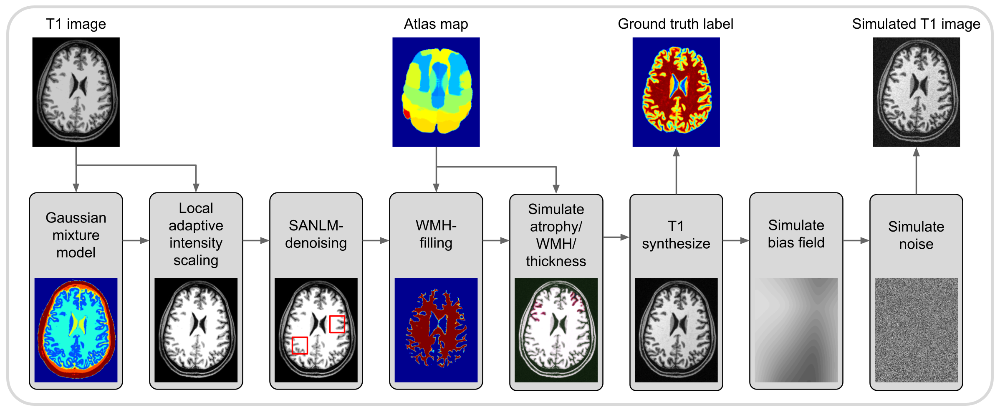
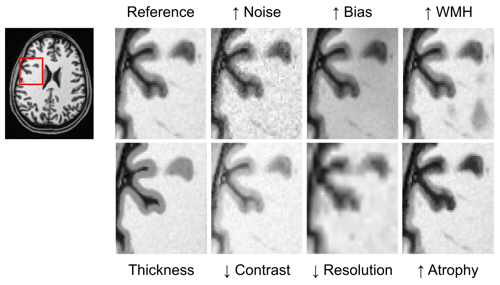

# MATLAB tools: mri_simulate and the thickness phantom

Simulates T1-weighted MR images with optional atrophy, cortical thickness control, WMHs, RF B1 inhomogeneities, and noise (Gaussian or Rician at a target WM SNR). Writes JSON sidecars with simulation metadata.



This folder holds the MATLAB tools of the repository. The Python package `t1sim`, which is being built to take their place, is described in the [README of the repository](../README.md).

| File | Purpose |
| --- | --- |
| `mri_simulate.m` | Simulates a T1w image and its ground truth from a real scan |
| `thickness_phantom.m` | Builds a folded phantom whose cortical thickness is exact |
| `thickness_phantom_eval.m` | Checks that phantom and scores a thickness measure on it |
| `BlaiottaTPM.nii`, `BlaiottaSegmentJob.m` | Tissue probability map and batch job of the segmentation |
| `rf100_A.nii`, `rf100_B.nii`, `rf100_C.nii` | The predefined bias fields |

## Quick start

```matlab
addpath('/path/to/T1-MRI-Phantom/matlab')

% Rician noise at a WM SNR of 40 (the default) and a simulated bias field of 20%
simu = struct('name', 'colin27_t1_tal_hires.nii');
rf   = struct('percent', 20, 'type', [2 0]);
mri_simulate(simu, rf);
```

This writes the simulated image, its ground truth label and a JSON sidecar for each into a `derivatives/mri_simulate-<version>` folder (see [Outputs](docs/usage.md#outputs)). The first run segments the input, which takes several minutes; later runs reuse the result.

## Documentation

| Document | Contents |
| --- | --- |
| [Quick reference](docs/quick-reference.md) | The workflow at a glance, common cases, parameter tables, troubleshooting |
| [Usage](docs/usage.md) | All inputs and their defaults, the outputs and their file names, examples |
| [Cortical thickness](docs/thickness.md) | A real brain with a chosen thickness, and the geometric thickness phantom with its evaluation |
| [Movement artefacts and ringing](docs/artefacts.md) | How both are made in k-space, their parameters and their limits |
| [Cleaning the ground truth](docs/cleanup.md) | Blood vessels, dura and periventricular partial volume in the label |
| [Affine registration of the output](docs/affine.md) | Image and ground truth on one common grid, e.g. for training data |

## Requirements

- MATLAB (R2017b or later recommended) with SPM12 (or SPM26) and CAT >= 26 in the path (`cat_main_LASsimple` is required and is checked for at startup)
- This folder (`matlab` in the repository) in the MATLAB path
- A T1-weighted NIfTI image, `.nii` or `.nii.gz` (default examples use `colin27_t1_tal_hires.nii`)
- `BlaiottaTPM.nii` and `BlaiottaSegmentJob.m` next to `mri_simulate.m`; the run stops with an error if either is missing

No MATLAB toolboxes beyond base MATLAB are needed. Distances use CAT's `cat_bwdist` (and `cat_vbdist` where the index of the nearest voxel is needed) rather than the Image Processing Toolbox, so results do not depend on which toolboxes are installed. The Parallel Computing Toolbox is used only when several input images are given.

## Overview
`mri_simulate` generates a realistic T1-weighted (T1w) image and its explicit ground truth from a high-quality input (e.g., 0.5 mm Colin27 or a custom T1w). Key steps:

- Start from a segmented T1w volume (GM, WM, CSF, and background) using SPM unified segmentation with the bundled Blaiotta head and neck TPM (`BlaiottaTPM.nii`, seven tissue classes) and its batch job `BlaiottaSegmentJob.m`, both stored next to `mri_simulate.m`. The result is cached as `<name>_seg8.mat` next to the input and is only an initialization.
- Locally normalize tissue intensities with CAT12 Local Adaptive Segmentation (LAS), denoise with SANLM and skull-strip with CAT's adaptive probability region-growing (APRG), then scale CSF/GM/WM to canonical values (1/2/3) to obtain a PVE-like label image.
- Optionally close WM holes to remove native WMHs before adding synthetic lesions.
- Insert user-defined anatomical changes: atlas-based atrophy (e.g., Hammers) and probabilistic WMHs.
- Synthesize a new T1w as the probability-weighted mixture of the tissue means (estimated from the SPM Gaussian mixture) using the modified PVE labels and the optional WMH class as weights; everything that is not brain keeps the intensity of the bias-corrected input, and the two blend continuously at the brain boundary. Optionally modulate with RF bias fields, apply a contrast change and add Rician or Gaussian noise.
- Outputs follow BIDS-like naming with JSON sidecars capturing all simulation parameters.

The tissue means come from the Gaussian mixture of the segmentation, with one exception: GM and WM use the mixing-weighted mean over all their Gaussians, while CSF uses only its darkest Gaussian. The segmentation models CSF with two Gaussians and the brighter one regularly covers GM, so their mean would be far too bright — and that value is not only the CSF intensity of the synthesis but also the low anchor of the LAS correction and the skull stripping. A cached segmentation that describes CSF by a single Gaussian is reported with a warning.

This label-driven synthesis minimizes dependence on the initial segmentation while preserving realistic tissue topology. RF fields can be predefined (MNI A/B/C) or simulated, and contrast-to-noise ratio plus voxel size are user-controlled.


