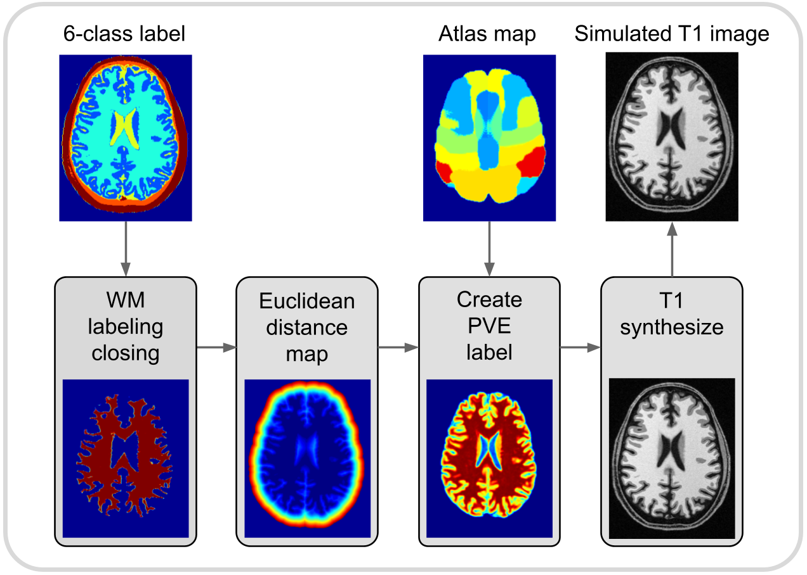
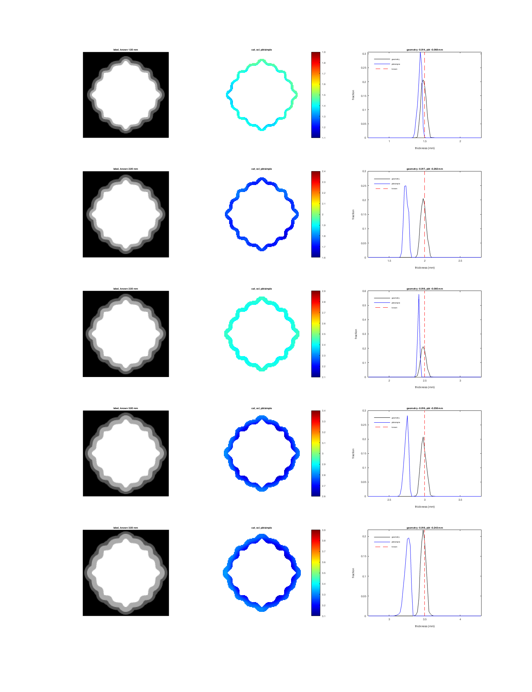

# Cortical thickness: simulation in a real brain and the geometric phantom

Part of the [documentation of the MATLAB tools](../README.md).

Two tools give a cortical thickness that is known beforehand. `mri_simulate` gives a real brain a cortex of a chosen thickness, and `thickness_phantom.m` builds an object whose thickness is exact by construction.

## Cortical thickness and PVE simulation
To validate cortical thickness pipelines, the label image can be edited directly:

- Cortical thickness is defined geometrically: the label is smoothed and grey-closed to repair thin WM, then GM is grown outward from the WM with CAT's exact Euclidean distance transform (`cat_bwdist`) up to the target thickness (global or 3-region using the neuromorphometrics atlas). No band is grown around the ventricles, the corpus callosum or any other non-cortical structure, since the CSF facing them is not a sulcus.
- Thickness values can vary across regions (e.g., frontal, occipital, remaining cortex) to produce known ground truth.
- The volume is internally resampled to 0.5 mm for the simulation and written back on the original or requested grid.
- Partial volume is approximated by jittering the tissue boundaries across 15 subvoxel offsets in [-0.25, 0.25] voxels and averaging hard labels (CSF=1, GM=2, WM=3), replacing the original SPM labels in synthesis.
- The original tissue fractions are blended back in where the simulation has nothing to add: inside the excluded structures, and deep inside the WM. The hard labels give a WM fraction of exactly 1 in the interior and therefore a perfectly flat WM, whereas the original fractions carry the local variation that a simulation without thickness manipulation shows. The blend stays a safe distance away from the GM/WM boundary, so the simulated thickness is untouched, and it is capped so that the ground truth cannot fall below the WM range.



## Geometric thickness phantom
`mri_simulate` gives a *real brain* a constant cortical thickness, so its ground truth is only as good as the segmentation it starts from. `thickness_phantom.m` answers the complementary question — what a thickness measure does when the geometry is known exactly — by building the object analytically instead:

- The WM is a sphere with regular folds, the GM is the band of constant thickness around it, and a CSF layer surrounds the GM.
- The phantom is free of artefacts by design and fully deterministic: no noise, no bias field, no random component anywhere. The error a thickness measure shows on it is its own theoretical error and nothing else.
- Outputs are a PVE label image (`_dseg.nii`, CSF=1, GM=2, WM=3) and the ideal T1w image (`_T1w.nii`) that belongs to it, each with a JSON sidecar that records the geometry.

### Why the thickness is exact
The GM is **not** made by offsetting the radius of the folded sphere. A radial offset of `t` gives a normal thickness of `t·cos(alpha)`, where `alpha` is the angle between the radius and the surface normal, so on the flanks of the folds the true thickness would come out too small. Instead the euclidean distance `D` to the WM is computed once with `cat_bwdist`, and **both cortical boundaries are level sets of that one distance map**: the WM/GM boundary is `D = wm_offset` and the GM/CSF boundary is `D = wm_offset + thickness`. Since `D` is 1-Lipschitz with a unit gradient, two of its level sets are exactly `thickness` apart everywhere, whatever the folds look like. This is the same construction `mri_simulate` uses for its cortical band, only starting from an analytic surface rather than a segmentation. The distance map is built on a supersampled grid (factor 3 by default), so the discretization of the surface stays well below the voxel size.

### Partial volume
The PVE follows the idea of `mri_simulate`: the tissue boundary is shifted across a set of sub-voxel offsets, each offset yields a hard label image, and the results are averaged. Here the offsets are applied to the distance map directly, which shifts both boundaries along their normal by a known amount. They are the midpoints of 15 equal intervals over one voxel, so for a locally flat boundary the average reproduces the exact linear PVE ramp — `mri_simulate` uses half that range because it applies the offsets to a label map it smoothed beforehand.

### Evaluation
`thickness_phantom_eval.m` checks two independent things, which is what makes the result interpretable: without the first, an error of the thickness measure cannot be told apart from an error of the phantom.

1. **Fidelity of the phantom.** The distance between the two boundaries is recovered from the label image alone — it is supersampled, `cat_bwdist` gives the distance from the WM surface, and that distance is read out on the GM/CSF isosurface at the sub-voxel crossings along the three axes (a layer of voxels would bias the readout by a good part of a sample). Tissue volumes are compared against the supersampled grid the phantom was built on. It also reports how much of the WM surface faces a *buried sulcus*, i.e. a fold narrower than twice the thickness where the CSF is squeezed out and the two GM banks touch — the situation that makes any thickness measure overestimate.
2. **Accuracy of a thickness measure**, optionally CAT's projection-based thickness `cat_vol_pbtsimple`, which takes exactly this kind of PVE label as input, over all GM voxels and on the central surface.



### Usage
```matlab
% one phantom with 2.5mm thickness at 0.5mm, then evaluate it
[~, ~, info] = thickness_phantom;
res = thickness_phantom_eval(info);

% a series of thickness values; they share the distance map, so this is
% barely slower than a single one
[~, ~, info] = thickness_phantom(struct('thickness', 1.5:0.5:3.5));
res = thickness_phantom_eval(info, struct('fig','phantom_qc.png'));

% the folding pattern of T1Prep/internal/thickness_phantom.py
thickness_phantom(struct('fold','spherical', 'folds',[6 6], 'radius',25, ...
                         'amplitude',2.5, 'thickness',3, 'csf',1));
```

Main parameters (see `help thickness_phantom` for all of them): `dim`, `vx`, `radius`, `amplitude`, `fold` (`'cartesian'` with a `wavelength`, or `'spherical'` with `folds` — note that the spherical pattern makes its folds arbitrarily fine towards the poles, where no voxel size resolves them), `thickness`, `csf`, `supersample`, `pve_steps`, `pve_range`.

### Results
Default phantom (radius 22 mm, fold amplitude 2.5 mm, wavelength 12 mm) at 0.5 mm, thickness 1.5–3.5 mm. `geometry` is the thickness recovered from the label image, i.e. the fidelity of the phantom; `pbt` is `cat_vol_pbtsimple` with its own defaults:

known | geometry bias | sd | pbt bias | sd | buried sulci
------|---------------|-----|----------|-----|-------------
1.5 mm | −0.014 | 0.036 | −0.068 | 0.027 | 0.0%
2.0 mm | −0.017 | 0.037 | −0.262 | 0.028 | 0.3%
2.5 mm | −0.018 | 0.036 | −0.085 | 0.013 | 4.2%
3.0 mm | −0.016 | 0.039 | −0.258 | 0.029 | 6.9%
3.5 mm | −0.018 | 0.035 | −0.243 | 0.039 | 10.3%

The geometric bias of about −0.017 mm is independent of the thickness and shrinks to −0.006 mm when the evaluation is supersampled by 5 instead of 3, i.e. most of what is left is the readout and not the phantom: the label image carries the requested thickness to well within a twentieth of a voxel. Tissue volumes agree with the supersampled reference to within 0.5% for CSF and WM and 1.5% for GM, the class that consists almost entirely of boundary voxels.

Against that, `cat_vol_pbtsimple` underestimates, and how much depends on the thickness in a way that is not monotonic. Its core algorithm is not the reason — with `pbtopt.supersimple = 1`, which switches the brain-specific refinements off, the bias is a near-constant −0.27 to −0.31 mm across the whole range. The jumps come from those refinements (myelin correction, sulcus/gyrus enhancement, sharpening, blood-vessel and topology correction), which sometimes recover about 0.2 mm of it and sometimes do not.
